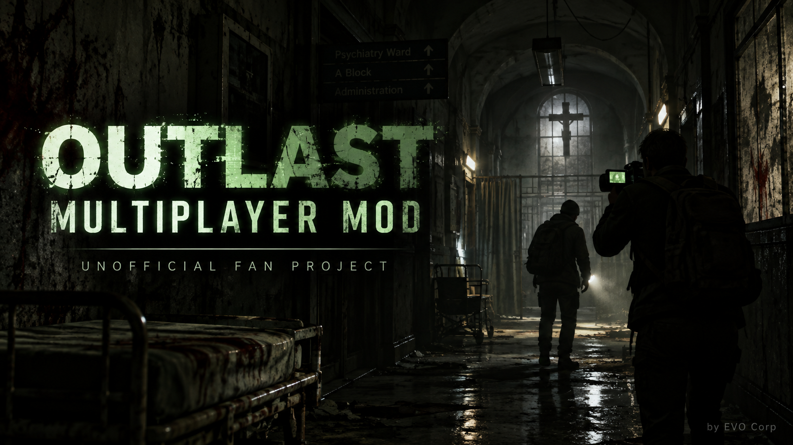
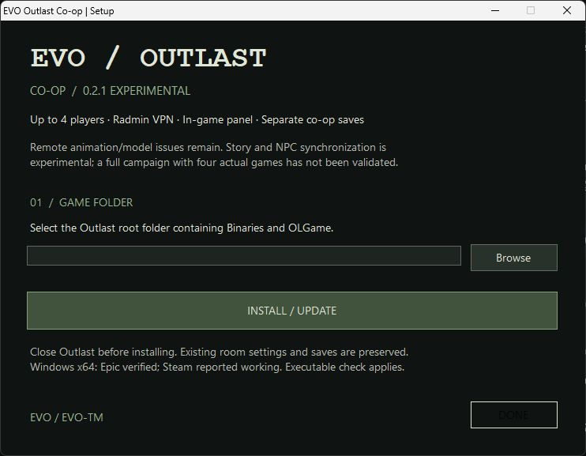

<b>Explore Outlast together, in the same world.</b> Windows x64 · Up to 4 players · Radmin VPN · Experimental co-op

<a href="https://github.com/EVO-TM/evo-outlast/releases/download/v0.2.1/EVO-Outlast-Coop-Setup-0.2.1-English.exe"><b>↓ DOWNLOAD THE ENGLISH INSTALLER — v0.2.1</b></a> <a href="https://github.com/EVO-TM/evo-outlast/releases/tag/v0.2.1">All downloads &amp; release notes</a> · <a href="docs/INSTALL.en.md">Installation guide</a> · <a href="docs/FEATURES.md">How co-op works</a> · <a href="docs/INSTALL.tr.md">Türkçe</a>

## About the project

**EVO Outlast Co-op** is an unofficial multiplayer mod for the first Outlast. One player hosts a session, and friends connect to explore the same map with visible remote characters. The project also includes an in-game room panel, separate co-op saves, and experimental synchronization for selected story interactions and enemies.

This is a **closed-source distribution repository**: it contains installers, documentation, artwork and issue tracking. The implementation stays in a private repository. GitHub's **Code → Download ZIP** and automatically generated **Source code** archives contain this public repository's documents, not the private implementation or a playable installer.

## Current release

**0.2.1 is an experimental test release.** Its gameplay DLL is unchanged from the previously played 0.2 build. The release updates installation and distribution; an English installer/launcher is available alongside the original Turkish installer. The current in-game co-op panel still uses Turkish labels; the English guide includes their translations.

Remote animation/model problems and the save → menu → Continue flow remain open. Full campaign progression, all puzzles, combat/damage transfer and four simultaneous game instances have not been fully validated. See [known issues](docs/KNOWN-ISSUES.md) before starting a long session.

## Features and status

| Feature | What this release provides |
|---|---|
| Shared-map presence | Remote player characters with position, rotation and velocity updates; two-player play reported working by the project owner |
| Up to four players | One host and up to three guests; four-peer protocol tests passed, four-game campaign testing pending |
| In-game controls | Co-op entry in the main menu and an **F9** room/save panel during gameplay |
| Host and join flow | Host starts from the opening checkpoint; guests explicitly load the host's checkpoint when joining |
| Co-op saves | Separate checkpoint, room settings and supported action history; not a complete world snapshot |
| Shared interactions | Experimental propagation for doors and supported use/one-shot touch triggers; not every quest or puzzle |
| Enemy targeting | Host assigns simulation ownership to the nearest eligible player; native combat transfer is still experimental |
| Cinematics | Run locally; remote avatars are hidden during the local player's cinematic mode |
| Networking | UDP over Radmin/LAN; no built-in cloud server, Cloudflare integration or automatic host migration |

Read the [feature and architecture overview](docs/FEATURES.md) for the exact scope of each system.

## Quick start

1. Install the same mod version on every player's own Outlast installation.
2. Join the same private Radmin VPN network.
3. Launch Outlast normally and select **Co-op** in the main menu.
4. The host enters a room code and selects **Oda aç ve başlat** — **Host and start**.
5. Guests enter the host's **Radmin IPv4 address**, matching room code and port, then select **Katıl ve başlat** — **Join and start**.

Press **F9** to manage the session or save during gameplay. The default port is **UDP 27851**. The host's game must remain running.

## Game compatibility

| Edition | Evidence |
|---|---|
| Epic / Outlast 1.0.8767.0 x64 | Executable fingerprint and local installation checks validated |
| Steam / Outlast x64 | Reported working by the project owner; the exact tested Steam build and executable hash have not been recorded |

**The installer checks the executable, not the store name.** The current package accepts one recorded `OLGame.exe` SHA-256. A Steam installation with that fingerprint can pass the check; a different Steam build may be rejected even though Steam play has been reported working. See the [compatibility details](docs/INSTALL.en.md#compatibility) for the accepted fingerprint and what to include in a compatibility report.

Outlast 2 and The Outlast Trials are outside this project's scope. Game files are not included; you need your own copy. This fan project is not developed, endorsed or affiliated with Red Barrels.

## Installer preview

The cover is promotional artwork supplied by the project owner. It is not presented as an in-game capture or proof of current animation/model quality.

## Support and project information

- [Installation, hosting, saves and removal](docs/INSTALL.en.md)
- [Feature details and networking model](docs/FEATURES.md)
- [Known issues and test coverage](docs/KNOWN-ISSUES.md)
- [Release validation](docs/RELEASE-VALIDATION.md)
- [Report a bug or suggest a feature](https://github.com/EVO-TM/evo-outlast/issues/new/choose)
- [Changelog](CHANGELOG.md) · [Third-party notices](NOTICE.md)

Include your store edition, game/mod versions, host/guest role, player count and reproduction steps in reports. Remove IP addresses, room codes and personal paths before sharing logs.

---

**Evo Corp / [EVO-TM](https://github.com/EVO-TM)** · © 2026 Evo Corp
